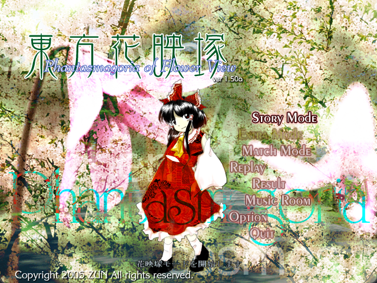
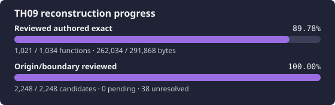

# 東方花映塚 ～ Phantasmagoria of Flower View

<p align="center">
  
</p>

<p align="center">
  
</p>

This project reconstructs the original Japanese TH09 version 1.50a
executable. It starts from an independently versioned, hash-attested target and
tracks boundary, origin, source presence, codegen exactness, native-product
closure, runtime semantics, and portability as separate facts.

## Exact target

Place your own legal copy at the ignored canonical path
`resources/th09.exe`. Repository tools use that path by default. An explicit
path or `TH09_TARGET_PATH` is supported only for deliberate local overrides;
normal reconstruction work uses the canonical path.

| Property | Required value |
| --- | --- |
| Version | original Japanese 1.50a |
| Size | `685,056` bytes |
| SHA-256 | `10350095bcf95edb59e03bee9849a2dc8a7714b4927ad5909c569c550fce6822` |
| MD5 | `cf634df46e05552e104fa97a971aaac0` |
| Image base | `0x00400000` |
| Entry point | `0x0047D45F` |

The pinned [thcrap version database](https://github.com/thpatch/thcrap-tsa/blob/f08b582ce57bce800955dd371fc9a68dbad5b324/base_tsa/versions.js)
classifies this exact SHA-256 and size as `th09`, `v1.50a`, `(original)` and
lists the English-patched executable under a different digest. The
[official 1.50a release post](https://kourindou.exblog.jp/1327589/) is dated
2005-10-08 JST, consistent with the target's PE timestamp.

```bash
python3 scripts/verify-target.py
python3 scripts/validate-tracking.py --require-target
python3 scripts/report-reconstruction-status.py
```

Analysis uses direct local Ghidra through `scripts/ghidra-analysis.py`.
The runner verifies disk/Program identity, i386 language, entry and every
file-backed mapped PE byte before analysis or export, then reuses the saved
project. See [`AGENTS.md`](AGENTS.md) and [`docs/TOOLS.md`](docs/TOOLS.md).

Original executables, game data, analysis databases, decompiler output, and
downloaded tools are private and never committed.

## Current status

TH09 reconstruction is active on explicit operator request. Work both complete
large owners and leaf functions; historical hypotheses and experiment notes are
not authoritative over fresh source/target evidence. The canonical ledger
currently reports **2,248 candidates, 1,035 authored mappings, 1,009 exact
functions and 26 non-exact functions / 43,512 bytes**. Exact authored-byte
coverage is **248,371 / 291,883 (85.0927%)**; the 98% milestone remains open.
Whole-product linking, runtime semantics and portability are separate,
unstarted gates.

The **2026-11-03 current next-agent guide** is
[TH09_NEXT_AGENT_HANDOFF_20261103.md](docs/TH09_NEXT_AGENT_HANDOFF_20261103.md).
Do not use the old `e4ea703b` Supervisor checkpoint as current HEAD;
check live `git status` and `git log` instead. Recent verified Player work
includes the 3,238-byte **exact** selector sharing native GameManager
bounds (`bc26b958`), the **non-exact** 1,900-byte movement owner with
**122** residual bytes (`3cd23f37`), and 572-byte **physically exact**
AddedState initializer with 552 canonical bytes and 20 reviewed tail bytes
(`a5dbf3b9`). High-value unfinished owners include `RunEcl` (30 unlike
bytes), `EnemyManager::OnUpdate` (13), `ReplayManager::SaveReplay` (3),
`TitleScreenView::DrawResult` (3), `GameplaySetupThread` (historical
1,689-byte /904 unlike), and `Supervisor::OnUpdate` (996 original-owned /
952 candidate-owned bytes; 791 overlapping differences and 44 absent).
The older [RE_HANDOFF.md](docs/RE_HANDOFF.md) retains historical evidence.
Do not confuse structural source recovery with a new exactness receipt.

Use focused complete-owner builds/replays for the changed units only. Do not
run a full cold replay for routine iteration. Commits use
`gpt-web: <concise English summary>` after each substantive checkpoint; keep
code and documentation commits coherent and make multiple checkpoints when a
session produces multiple reviewable advances.

The PE and Rich header identify Microsoft Visual C++ .NET 2003 build 3077.
Some runtime-library contributions and compiler-generated helpers are proven,
but the complete translation-unit graph, resources, data owners, compiler
profiles, and link order remain open. `config/build.toml` records that state
instead of pretending the project is buildable.

Run `python3 scripts/progress.py` to regenerate the status card,
`python3 scripts/validate-docs.py` to catch stale handoff totals, percentage,
98% gap, non-exact routing and accepted-owner manifest/receipt entries, and
`python3 scripts/ci.py` for the full target-independent validation set when
changing shared validation/CI tooling. Ordinary exact checkpoints use affected
complete-owner comparisons and checks relevant to the diff; see
the validation scope in `docs/RE_WORKFLOW.md`.
Canonical build caches may be absent after reviewed cleanup; replay a function
by running `python3 scripts/build-match-unit.py --unit NAME` before its
corresponding comparison or non-crediting inspector. Preview disposable-cache
cleanup with `python3 scripts/clean-generated-artifacts.py`. Analysis objects
are preserved by default; `--reviewed-objects` accepts an explicit path/SHA-256
list for obsolete objects. Changed files invalidate the reviewed plan.
Git-backed old source/config/doc copies can be restored with
`scripts/restore-analysis-snapshots.py`; the handoff names the recovery
manifest. The 2026-11-03 handoff includes a **locally retained, verified lossless
archive of unreferenced historical experiments** and reviewed `build/`
cache cleanup; about **590.5 MiB of net logical file bytes** were reclaimed.
See `docs/RE_ARTIFACT_CLEANUP_HISTORY.md` for archive SHA-256, protected
scopes and selective restoration. The archive is ignored and not cloned.

Use `docs/RE_ARTIFACT_CLEANUP_HISTORY.md` for the actual cleaned
scopes and retained evidence.

## Required phase order

1. Preserve the reviewed boundary/origin inventory and recover remaining exact
   VC7.1 authored units.
2. Close and exercise the faithful Windows i386 product, including static data
   ownership, initializers, resources, libraries, and runtime scenarios.
3. Perform semantic reconstruction with two independent runtime Oracles: the
   original target and the reconstructed native i386 product.
4. Start a portability branch only after the native semantic baseline is
   trustworthy.

Exact functions do not imply a complete or runnable product. A modern port can
hide missing original data owners, ABI behavior, and initialization, so it is
not an acceptable shortcut around the native-product stage.

## Project map

- [`AGENTS.md`](AGENTS.md) — mandatory session, evidence, and checkpoint rules.
- [`config/target.toml`](config/target.toml) — exact target and observed PE/toolchain facts.
- [`config/build.toml`](config/build.toml) — whole-product graph and explicit unknowns.
- [`docs/RE_WORKFLOW.md`](docs/RE_WORKFLOW.md) — bounded reconstruction loop and stage gates.
- [`docs/ORACLES.md`](docs/ORACLES.md) — what can falsify or accept each claim.
- [`docs/TH09_NEXT_AGENT_HANDOFF_20261103.md`](docs/TH09_NEXT_AGENT_HANDOFF_20261103.md) — current restart scope, verified owner boundaries, and cleanup guidance.
- [`docs/RE_HANDOFF.md`](docs/RE_HANDOFF.md) — dated historical evidence and ledger-backed tables; use the current restart guide first.
- [`docs/ARCHITECTURE.md`](docs/ARCHITECTURE.md) — target facts and maintained source/verification map.
- [`docs/RE_HANDOFF_CHECKPOINT_ARCHIVE_20261018.md`](docs/RE_HANDOFF_CHECKPOINT_ARCHIVE_20261018.md) — frozen historical checkpoints; use the active handoff, not this archive, for current facts.
- [`docs/KNOWLEDGE_BASE.md`](docs/KNOWLEDGE_BASE.md) — durable TH09-only facts.
- [`docs/TOOLS.md`](docs/TOOLS.md) — direct Ghidra and pinned compiler routing.
- [`docs/PROGRESS.md`](docs/PROGRESS.md) — generated ledger totals.
- [`docs/SMALL_FUNCTION_FRONTIER.md`](docs/SMALL_FUNCTION_FRONTIER.md) — short open leaf owners.
- [`docs/RE_ARTIFACT_CLEANUP_HISTORY.md`](docs/RE_ARTIFACT_CLEANUP_HISTORY.md) — verified generated-cache deletion audits and preservation policy.
- [Touhou Reconstruction Factory](https://github.com/N0zoM1z0/touhou-reconstruction-factory) — shared ontology, workflow, and cross-game knowledge.

## License

This integration branch includes GPL-3.0-only adaptations from Cirno-Labs/th09.
The combined reconstructed program is distributed under GPL-3.0-only; see
[THIRD_PARTY_NOTICES.md](THIRD_PARTY_NOTICES.md) and
[LICENSES/GPL-3.0-only.txt](LICENSES/GPL-3.0-only.txt) for scope and attribution.
Pre-existing repository-authored code and documentation retain their MIT grant
in [LICENSE](LICENSE).
This does not grant rights to the original game or its assets.
