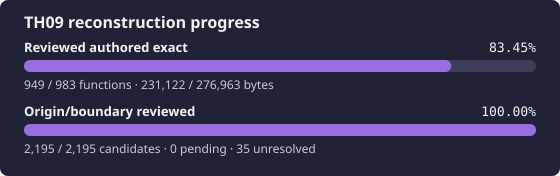

# 東方花映塚 ～ Phantasmagoria of Flower View

<p align="center">
  
</p>

<p align="center">
  
</p>

This project reconstructs the original Japanese TH09 version 1.50a
executable. It starts from an independently versioned, hash-attested target and
tracks boundary, origin, source presence, codegen exactness, native-product
closure, runtime semantics, and portability as separate facts.

## Exact target

Place your own legal copy at the ignored canonical path
`resources/th09.exe`. Repository tools use that path by default. An explicit
path or `TH09_TARGET_PATH` is supported only for deliberate local overrides;
normal reconstruction work uses the canonical path.

| Property | Required value |
| --- | --- |
| Version | original Japanese 1.50a |
| Size | `685,056` bytes |
| SHA-256 | `10350095bcf95edb59e03bee9849a2dc8a7714b4927ad5909c569c550fce6822` |
| MD5 | `cf634df46e05552e104fa97a971aaac0` |
| Image base | `0x00400000` |
| Entry point | `0x0047D45F` |

The pinned [thcrap version database](https://github.com/thpatch/thcrap-tsa/blob/f08b582ce57bce800955dd371fc9a68dbad5b324/base_tsa/versions.js)
classifies this exact SHA-256 and size as `th09`, `v1.50a`, `(original)` and
lists the English-patched executable under a different digest. The
[official 1.50a release post](https://kourindou.exblog.jp/1327589/) is dated
2005-10-08 JST, consistent with the target's PE timestamp.

```bash
python3 scripts/verify-target.py
python3 scripts/validate-tracking.py --require-target
python3 scripts/report-reconstruction-status.py
```

The current local session calls `get_metadata` with exactly `{}` through the
direct IDA Pro MCP provider, then runs `scripts/check-ida-mcp.py` to compare
entry and distributed mapped bytes with the verified executable. See
[`AGENTS.md`](AGENTS.md) and [`docs/TOOLS.md`](docs/TOOLS.md) before analysis.
The separate Factory/Web client uses the attested `th09-ida` provider.

Original executables, game data, IDA databases, decompiler output, and
downloaded tools are private and never committed.

## Current status

The October 24 request is a clean handoff to a successor agent. The persistent
automatic reconstruction goal was cleared; the **98% exact reviewed-authored
byte** milestone remains unfinished. Use [the handoff](docs/RE_HANDOFF.md) for the
current code map, remaining large functions, restart commands and retained
local evidence. [PROGRESS.md](docs/PROGRESS.md) is generated from the live ledgers;
historical knowledge-base measurements do not replace them. Exact authored-byte
coverage does not establish a complete executable or runnable product.

When reconstruction resumes, prioritize complete RunEcl and EnemyManager,
followed by other large functions. Use direct IDA Pro MCP, repository Bash and
the pinned VC7.1 compiler, compile serially at lowered priority, and reuse
unchanged source/profile-bound proofs. New English commits use `gpt-6.1-sol: ...`
with the identity/trailer in [AGENTS.md](AGENTS.md).

Every new session must attest the target and live IDA database. Current
exact/non-exact state comes from `config/functions.csv`,
`config/matches.csv`, `config/match-units.toml`, and a fresh status report.
`docs/KNOWLEDGE_BASE.md` indexes durable evidence and bounded investigation
notes; historical measurements do not replace the live ledgers.

The PE and Rich header identify Microsoft Visual C++ .NET 2003 build 3077.
Some runtime-library contributions and compiler-generated helpers are proven,
but the complete translation-unit graph, resources, data owners, compiler
profiles, and link order remain open. `config/build.toml` records that state
instead of pretending the project is buildable.

Run `python3 scripts/progress.py` to regenerate the status card,
`python3 scripts/validate-docs.py` to catch stale handoff totals, percentage,
98% gap, non-exact routing and accepted-owner manifest/receipt entries, and
`python3 scripts/ci.py` for the target-independent validation set. Canonical
build caches may be absent after reviewed cleanup; replay a function by
running `python3 scripts/build-match-unit.py --unit NAME` before its
corresponding comparison or non-crediting inspector. Preview disposable-cache
cleanup with `python3 scripts/clean-generated-artifacts.py`. Its `--apply`
scope also includes compiler objects throughout `.analysis/`, which may be
essential source-bound evidence; review each path and retain unique proofs.
Use [`docs/RE_ARTIFACT_CLEANUP_HISTORY.md`](docs/RE_ARTIFACT_CLEANUP_HISTORY.md)
for the actual cleaned scopes and archive recovery instructions.

## Required phase order

1. Preserve the reviewed boundary/origin inventory and recover remaining exact
   VC7.1 authored units.
2. Close and exercise the faithful Windows i386 product, including static data
   ownership, initializers, resources, libraries, and runtime scenarios.
3. Perform semantic reconstruction with two independent runtime Oracles: the
   original target and the reconstructed native i386 product.
4. Start a portability branch only after the native semantic baseline is
   trustworthy.

Exact functions do not imply a complete or runnable product. A modern port can
hide missing original data owners, ABI behavior, and initialization, so it is
not an acceptable shortcut around the native-product stage.

## Project map

- [`AGENTS.md`](AGENTS.md) — mandatory session, evidence, and checkpoint rules.
- [`config/target.toml`](config/target.toml) — exact target and observed PE/toolchain facts.
- [`config/build.toml`](config/build.toml) — whole-product graph and explicit unknowns.
- [`docs/RE_WORKFLOW.md`](docs/RE_WORKFLOW.md) — bounded reconstruction loop and stage gates.
- [`docs/ORACLES.md`](docs/ORACLES.md) — what can falsify or accept each claim.
- [`docs/RE_HANDOFF.md`](docs/RE_HANDOFF.md) — current state, retained evidence, and restart checks.
- [`docs/ARCHITECTURE.md`](docs/ARCHITECTURE.md) — target facts and maintained source/verification map.
- [`docs/RE_HANDOFF_CHECKPOINT_ARCHIVE_20261018.md`](docs/RE_HANDOFF_CHECKPOINT_ARCHIVE_20261018.md) — frozen historical checkpoints; use the active handoff, not this archive, for current facts.
- [`docs/KNOWLEDGE_BASE.md`](docs/KNOWLEDGE_BASE.md) — durable TH09-only facts.
- [`docs/TOOLS.md`](docs/TOOLS.md) — local and Factory tool routing.
- [`docs/PROGRESS.md`](docs/PROGRESS.md) — generated ledger totals.
- [`docs/SMALL_FUNCTION_FRONTIER.md`](docs/SMALL_FUNCTION_FRONTIER.md) — short open leaf owners.
- [`docs/RE_ARTIFACT_CLEANUP_HISTORY.md`](docs/RE_ARTIFACT_CLEANUP_HISTORY.md) — verified generated-cache deletion audits and preservation policy.
- [Touhou Reconstruction Factory](https://github.com/N0zoM1z0/touhou-reconstruction-factory) — shared ontology, workflow, and cross-game knowledge.

## License

Repository-authored code and documentation are provided under the MIT License.
This does not grant rights to the original game or its assets.
