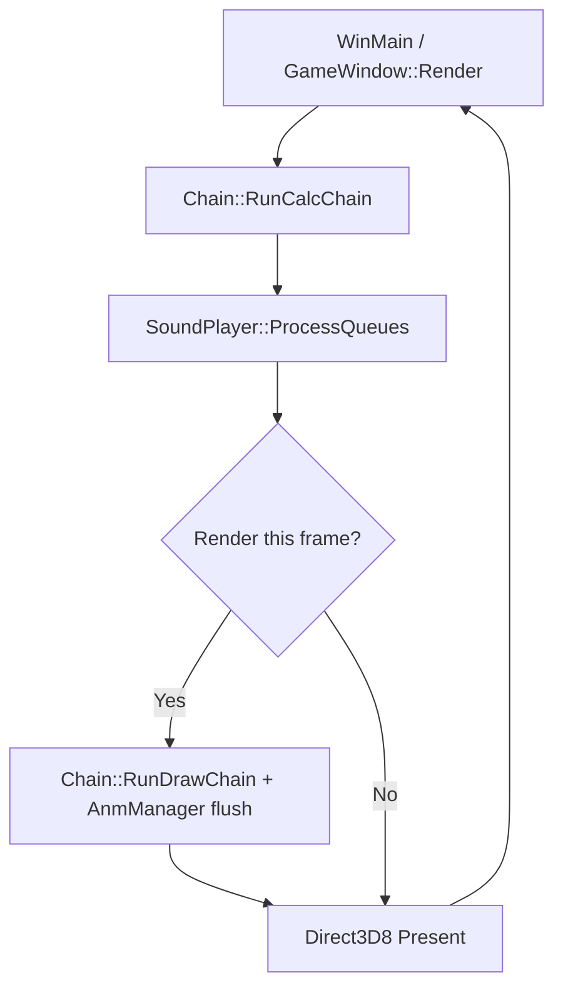

# TH09 project and engine guide

This project reconstructs the original Japanese Touhou 9 (*Phantasmagoria of
Flower View*) v1.50a executable with pinned VC7.1 (`13.10.3077`). This guide
explains how the reconstructed engine fits together at runtime. For target
identity and exactness gates see [ARCHITECTURE.md](ARCHITECTURE.md) and
[ORACLES.md](ORACLES.md); for per-file compiler ownership see
[SOURCE_MAP.md](SOURCE_MAP.md); for subsystem declarations and protocols see
[SEMANTIC_INDEX.md](SEMANTIC_INDEX.md).

## Build products

| Product | Purpose | Command |
| --- | --- | --- |
| Scoped exact comparison | Verify individual reconstructed functions and relocations against `resources/th09.exe`. | `python3 -B scripts/replay-scoped-exact.py --source src/FILE.cpp` |
| Trial / reversed i386 links | Position-independence (PI) and whole-image link verification with retail version identity check. | `python3 -B scripts/trial-link.py link` / `--reverse`, then `scripts/verify-trial-layouts.py` |
| Playable Windows i386 link | Playable image accepting archive version identifiers (`-DTH09_PLAYABLE`), verified on replays and live playthroughs. | `python3 -B scripts/trial-link.py link --playable` |

## A frame through the engine

[WinMain.cpp](../src/WinMain.cpp) initializes DirectInput, the window, and the
message loop. `GameWindow::Render` drives timing, executes the calculation
chain, processes DirectSound queues, and runs the drawing chain when the frame
is not skipped.

[Chain.hpp](../src/Chain.hpp) maintains two priority-ordered doubly linked
lists (`calcChain` and `drawChain`). Callbacks return a `ChainCallbackResult`
(`CONTINUE`, `CONTINUE_AND_REMOVE_JOB`, `EXECUTE_AGAIN`, `BREAK`,
`EXIT_GAME_SUCCESS`, `EXIT_GAME_ERROR`, or `RESTART_FROM_FIRST_JOB`).

[SupervisorUpdate.cpp](../src/SupervisorUpdate.cpp) owns top-level screen
transitions (`SupervisorState` in [SupervisorStates.hpp](../src/SupervisorStates.hpp)):
switching between the title screen (`TitleCalcCallback` / `TitleDrawCallback`),
active matches (`GameManagerSetupLayout`), and the ending sequence (`Ending`).
It also services network synchronization (`Supervisor::UpdateNetworkService`)
and preloaded animation assets.

## Dual-side PvP architecture

Unlike single-playfield Touhou titles, TH09 runs two split-screen gameplay
sides simultaneously inside `g_GameManager` (`sides[0]` for P1 and `sides[1]`
for P2/CPU), plus a third shared viewport and shared `EffectManager`:

| Subsystem | Per-side vs shared | Core landmarks |
| --- | --- | --- |
| Runtime control & netplay | Shared (`g_Supervisor`) | [Supervisor.hpp](../src/Supervisor.hpp), [SupervisorUpdate.cpp](../src/SupervisorUpdate.cpp), [SupervisorNetworkService.hpp](../src/SupervisorNetworkService.hpp) |
| Match & side state | Shared manager + 2 playable `0x38`-byte side records | [GameManagerSideState.hpp](../src/GameManagerSideState.hpp), [GameManagerSetup.cpp](../src/GameManagerSetup.cpp) |
| Playfields & backgrounds | One `Background` per side (`viewportIndex` 0 / 1) | [Background.hpp](../src/Background.hpp), [BackgroundStageScript.cpp](../src/BackgroundStageScript.cpp), [BackgroundRender.cpp](../src/BackgroundRender.cpp) |
| Players, shots, charge attacks | One `0x30F70`-byte `PlayerLifecycleView` per side | [PlayerLifecycleView.hpp](../src/PlayerLifecycleView.hpp), [PlayerRuntime.cpp](../src/PlayerRuntime.cpp), [PlayerMovement.cpp](../src/PlayerMovement.cpp) |
| Enemies & ECL scripts | One `0x2AC450`-byte `EnemyManager` per side | [EnemyManager.hpp](../src/EnemyManager.hpp), [EclManager.cpp](../src/EclManager.cpp), [EclOperands.cpp](../src/EclOperands.cpp) |
| Bullets & lasers | One `EtamaController` per side | [BulletManager.hpp](../src/BulletManager.hpp), [EtamaControllerDraw.cpp](../src/EtamaControllerDraw.cpp) |
| Cross-side attacks | `ExAttack` (27 attack families) and `CardAttack` (spell/boss attacks) | [ExAttackController.hpp](../src/ExAttackController.hpp), [CardAttack.cpp](../src/CardAttack.cpp) |
| Effects | Per-side `EffectManager` plus shared `EffectManager` | [EffectManager.hpp](../src/EffectManager.hpp), [EffectIds.hpp](../src/EffectIds.hpp) |
| HUD, portraits & dialogue | Per-side `FrontSide` + `FrontMessage` script engine | [FrontSide.hpp](../src/FrontSide.hpp), [FrontMessageRuntimeView.hpp](../src/FrontMessageRuntimeView.hpp), [FrontMessageUpdate.cpp](../src/FrontMessageUpdate.cpp) |
| Animation & rendering | Shared `AnmManager` and `AsciiManager` | [AnmManager.hpp](../src/AnmManager.hpp), [AnmManagerExecuteScript.cpp](../src/AnmManagerExecuteScript.cpp), [AsciiManager.hpp](../src/AsciiManager.hpp) |
| Audio | Shared `SoundPlayer` (54 SFX slots, 39 WAV buffers) & `MidiOutput` | [SoundPlayer.hpp](../src/SoundPlayer.hpp), [SoundIds.hpp](../src/SoundIds.hpp), [Midi.hpp](../src/Midi.hpp) |
| Replays & input | 3 `ReplayInputState` records (P1, P2, shared UI/dialogue) | [ReplayInput.cpp](../src/ReplayInput.cpp), [TitleScreenReplayView.hpp](../src/TitleScreenReplayView.hpp) |

## Scripts and resource namespaces

- **ECL (`EclManager.cpp` + `EclOpcodes.hpp` + `EclOperandIds.hpp`)**:
  drives enemy movement, bullet patterns, remote subroutines, and cross-side
  triggers via a 187-opcode interpreter and `0x2710+` typed operand selectors.
- **Enemy stage timeline (`EnemyScheduleRuntimeAdvance.cpp`)**: spawns waves,
  signals cross-timeline events, and synchronizes remote enemy slots.
- **Background `.std` script (`BackgroundStageScript.cpp`)**: runs 35 opcodes
  (`0..34`) controlling camera position/look-at/up/FOV interpolation, cubic
  Hermite paths, fog fades, and procedural camera motion modes (`0..4`).
- **FrontMessage dialogue script (`FrontMessageUpdate.cpp`)**: decodes
  XOR-obfuscated Shift-JIS lines, switches portrait sprites/interrupts, plays
  BGM, and triggers stage transitions.
- **ANM namespaces**: keep manager file slots (`ANM_FILE_SLOT_*`),
  file-local script IDs, sprite IDs, and runtime `AnmVm` array indices
  distinct—an index from one namespace is never interchangeable with another.

## Glossary

| Term | Meaning in this repository |
| --- | --- |
| VC7.1 | Visual C++ .NET 2003 (`13.10.3077`), the pinned reconstruction compiler. |
| Carrier | A `(source, compiler profile)` pair compiled to a COFF `.obj` for exact comparison or trial linking. |
| PI (Position Independence) | Code and data move freely at link time (normal, reversed, relocated bases) while every reference reaches its target. |
| `*View` type | A layout-compatible struct/class overlay built during exact reconstruction; consolidated toward canonical owners during semantic cleanup. |
| `/ALTERNATENAME` | Linker symbol alias binding a view-qualified symbol to the canonical definition at the same target VA. |
| Dual Oracle | Verifying a change against both VC7.1 exact comparison and retail-vs-rebuilt runtime/replay traces. |
